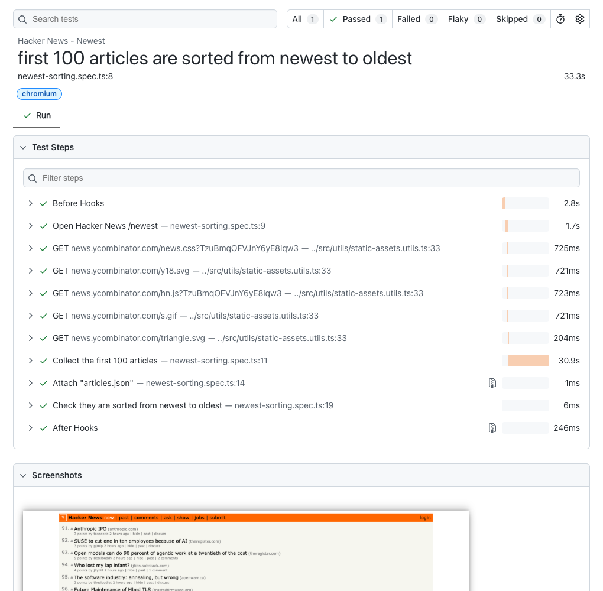

# Hacker News – Playwright E2E Tests

[](https://github.com/AhmedGabr496/hn-playwright-tests/actions/workflows/playwright.yml)

An automated end-to-end test for [Hacker News](https://news.ycombinator.com), written in **TypeScript** with **Playwright** using the **Page Object Model**. It opens the **Newest** page in a real browser, collects the first **100 articles**, and checks that they are sorted from **newest to oldest**. A **CI/CD pipeline in GitHub Actions** runs it on every commit to `master`.

## Task requirements

| Requirement | How it's covered |
| --- | --- |
| Use TypeScript and Playwright | TypeScript (strict mode) with `@playwright/test`; `npm run typecheck` checks the types locally and in CI. |
| Visit Hacker News – Newest | Opens [`news.ycombinator.com/newest`](https://news.ycombinator.com/newest) in Chromium and pages through it by clicking **More**. |
| Validate that the first 100 articles are sorted from newest to oldest | Collects exactly 100 articles with their exact publish times and asserts there are 100 and none is newer than the one above it. |
| The test executes successfully without errors | `npm test` passes in about 35 seconds. The check was also verified to fail when two articles are swapped ([example](#when-it-fails)). |
| A basic CI/CD pipeline job on every commit to `master` | [`playwright.yml`](.github/workflows/playwright.yml) runs on every push to `master`: install, type-check, test, upload the report ([run history](https://github.com/AhmedGabr496/hn-playwright-tests/actions/workflows/playwright.yml)). |

## How the test works

1. **Opens** `/newest` in Chromium.
2. **Reads each article**: id, title and exact publish time, taken from the page's timestamp (e.g. `2026-11-03T10:05:59`, UTC) rather than text like "5 minutes ago".
3. **Pages like a reader**: scrolls each page for about 10 seconds, then clicks **More**, until it has 100 articles (4 pages of 30).
4. **Checks the order**: compares every pair of neighbours (1 with 2, … 99 with 100). Each article must be the same age as, or older than, the one above it. Articles posted in the same second are fine.

### When it fails

The test fails if fewer than 100 articles are found, or if any pair is out of order. The error names every bad pair. This is real output from swapping the times of the first two articles:

```text
Error: Articles out of newest → oldest order
+ Received: [{ position: 1,
    article:    "2026-11-03T10:03:18.000Z | #50350072 | Parasoft Alternative to API Service Virtualization",
    followedBy: "2026-11-03T10:05:59.000Z | #50350061 | Price rises for some 16GB Raspberry Pi products" }]
```

It also fails with a clear message if a page can't be loaded, a timestamp can't be read, or the page stops responding (15 s per action, 30 s per page load).

### Hacker News' rate limit

Hacker News answers too many requests from one IP address with **HTTP 429** or **503** ("Sorry, we're not able to serve your requests this quickly"). To stay polite, the test paces itself like a person, uses full Chromium so its requests look like a normal browser's, and downloads CSS, JavaScript and images only once. If a page is still throttled, it waits 10 seconds and reloads it, up to 3 times; any other error fails straight away.

> **Note:** GitHub's shared CI runners use IP addresses that Hacker News often throttles, so a CI run can fail even when the test and the site are fine. **Re-run jobs** usually gets a different runner. Locally the test passes reliably.

## Getting started

Requires **Node.js 24** (see `.nvmrc`).

```bash
npm ci                                       # install dependencies
cp .env.example .env                         # create your local settings
npx playwright install --no-shell chromium   # install the browser
```

| Command | What it does |
| --- | --- |
| `npm test` | Runs the test headless (about 35 seconds) |
| `npm run test:headed` | Runs it in a visible browser window |
| `npm run report` | Opens the HTML report of the last run |
| `npm run typecheck` | Checks the TypeScript code |

## The test report

Every run, locally or on CI, produces a Playwright HTML report:



| Section | What you see | When |
| --- | --- | --- |
| Test steps | **Open Hacker News /newest**, **Collect the first 100 articles** and **Check they are sorted from newest to oldest**, with durations (plus one `GET …` line per static file the cache downloads) | Always |
| Screenshots and Videos | A full-page screenshot of the last page and a video of the whole run | Always |
| Attachments | `articles.json`: the 100 articles checked, with id, rank, title and publish time | Always |
| Errors | The failure message, with every out-of-order pair or the page that couldn't load | On failure |
| stderr | `Rate limited loading … retrying in 10s` lines | When Hacker News throttled the run |
| Trace | A step-by-step replay of actions, network requests and page snapshots | On CI, when a failed test is retried |

- **Locally:** `npm test` prints a summary and writes the report to `playwright-report/`; `npm run report` opens it. Add `--trace on` to record a trace locally too.
- **On CI:** the run page shows the result and, on failure, the error as an annotation. The full report is uploaded as the **`playwright-report`** artifact (kept 14 days): download it from the run's *Artifacts*, unzip it, and run `npx playwright show-report <folder>`.

## Configuration

Settings come from environment variables: locally from `.env` (git-ignored), on CI from the repository's **Variables** (*Settings → Secrets and variables → Actions → Variables*).

| Variable | Required | Default | What it controls |
| --- | --- | --- | --- |
| `BASE_URL` | Yes | – | The site under test: `https://news.ycombinator.com` |
| `PAGE_PAUSE_MS` | No | `10000` | Milliseconds spent scrolling each page before clicking **More** |
| `RATE_LIMIT_RETRIES` | No | `3` | Reloads of a throttled page before the test fails |
| `RATE_LIMIT_RETRY_DELAY_MS` | No | `10000` | Milliseconds to wait before each reload |

A missing or invalid value stops the run straight away with a clear message.

## CI/CD

The [GitHub Actions workflow](.github/workflows/playwright.yml) runs on every push to `master`, or by hand from *Actions → Playwright Tests → Run workflow*. It installs the dependencies, type-checks, installs Chromium, runs the test and uploads the report. A failed test is retried once, with a trace. The job only has read access to the repository.

**One-time setup:** add the repository variable `BASE_URL` = `https://news.ycombinator.com`.

## Project structure

```text
├── .github/workflows/playwright.yml    # CI/CD pipeline
├── src/
│   ├── config/env.ts                   # reads and checks the environment variables
│   ├── pages/base.page.ts              # shared navigation: pacing, clicking links, rate-limit retries
│   ├── pages/newest.page.ts            # the /newest page: collects articles through "More"
│   ├── components/article-list.component.ts  # reads the article rows (the only code that knows the HTML)
│   ├── fixtures/index.ts               # gives the test a ready page object, caches static files
│   └── utils/                          # sort check and static-file cache
├── tests/newest-sorting.spec.ts        # the test
└── playwright.config.ts                # timeouts, report, browser
```

The test only lists the steps; page objects know how to use the site, and one component knows its HTML, so a markup change is fixed in one place. To add a page, extend `BasePage` in `src/pages/` and register it in `src/fixtures/index.ts`; new tests go in `tests/` and import `test` and `expect` from `@fixtures`.
